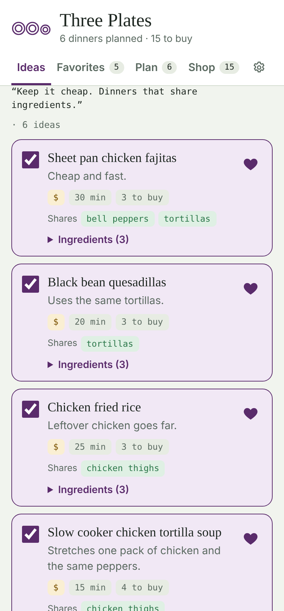
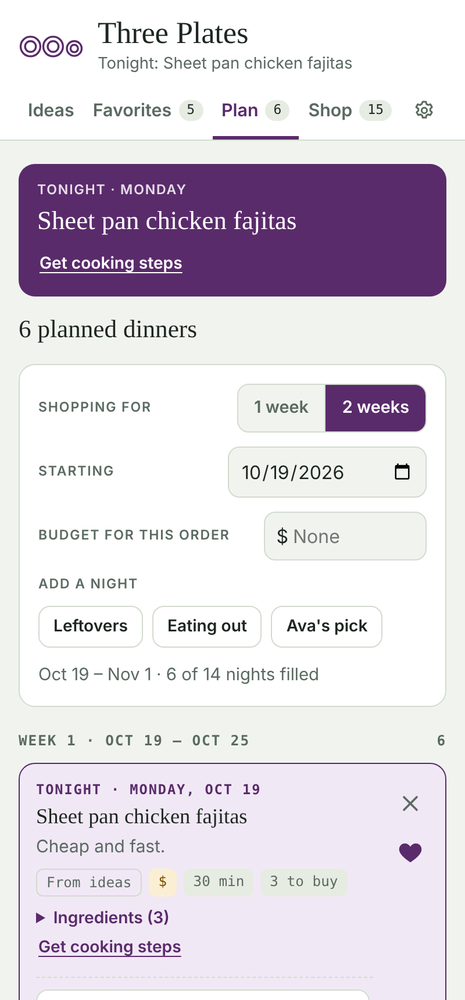
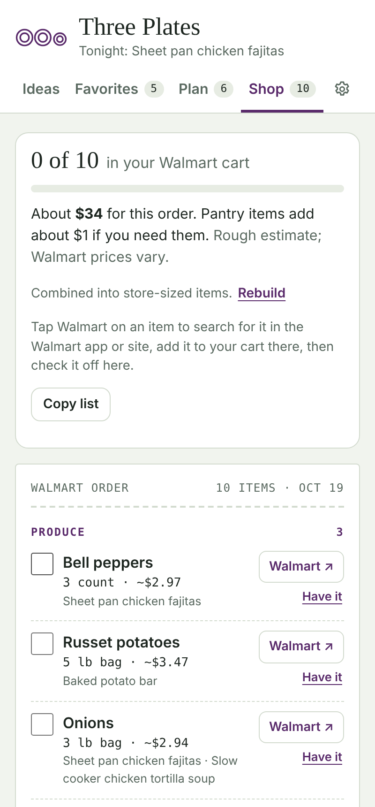
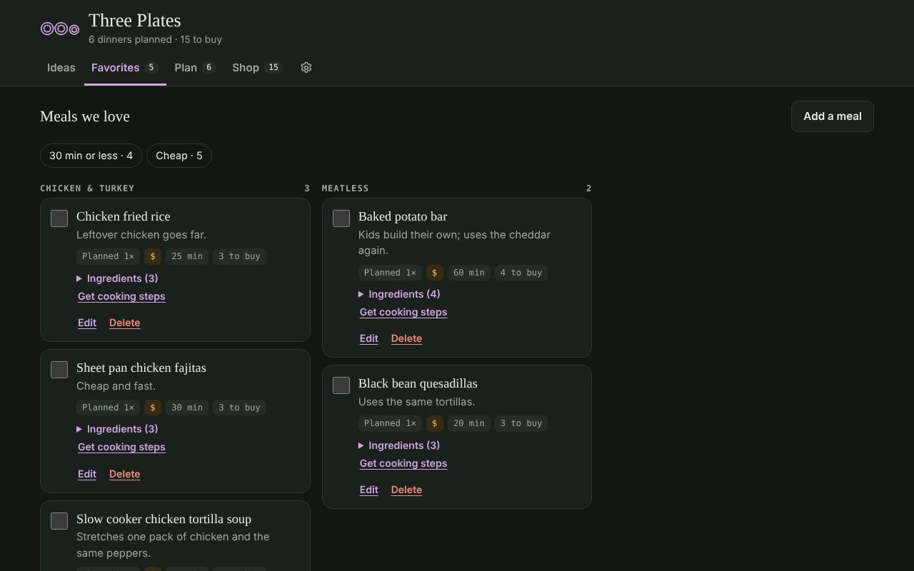
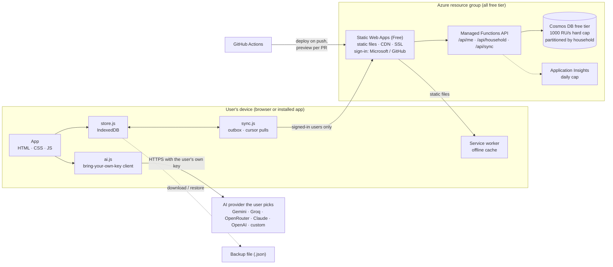

# Three Plates

A free, private dinner planner. Plan one or two weeks of dinners, get AI meal ideas, and turn it all into one grocery list with a store link for every item.

It works offline-first in the browser with no account. Sign in, and your household shares one plan across every device. It costs **$0** to host on Azure.

<p>
  
  
  
</p>


**Stack:** HTML, CSS and vanilla JavaScript (no framework, no build step) · IndexedDB · Service worker (installable, works offline) · Azure Static Web Apps (Free) with built-in auth and managed Functions (Node 20) · Azure Cosmos DB (free tier) · Application Insights · Terraform · GitHub Actions

---

## What it does

- **Ideas.** Describe the week ("keep it cheap, share ingredients") and an AI model suggests up to 14 dinners sized for your household, with cost, time, and the ingredients they share. Ideas stream in as they're written. It also knows what's already in your kitchen, which meals you love, and which ones you didn't.
- **Favorites.** Save meals you love. They sort themselves into sections by main ingredient, with the most-planned meals first. Type a meal name and the AI guesses the ingredients. Paste a recipe or snap a photo of one, and it pulls out the ingredients and steps.
- **Servings that scale.** Set how many people you cook for, and change any single dinner (guests Saturday, leftovers for lunch Tuesday). Each favorite remembers how many its recipe serves, and the shopping list scales every ingredient to match before combining.
- **Plan.** Build a one- or two-week plan on real dates. Fill open nights in one tap, and add leftovers nights, eating-out nights, and pick nights for each person. A Tonight card shows cooking steps, and an after-dinner prompt asks how it went.
- **Shop.** One combined list grouped by aisle and converted to store-sized packages, with a store search link for each item. It shows a rough cost estimate, checks it against your budget, and can suggest cheaper swaps.
- **Family sync.** Sign in with Microsoft or GitHub, start a household, and share an invite code or link. Everyone's phones and laptops share one plan, favorites list and shopping list. Edits made offline sync when the device is back online.
- **More.** A batch-prep checklist, a kitchen inventory (typed, or scanned from a fridge photo), likely leftovers carried into the next plan, and past plans you can rate or run again.

Everything except AI and sync works with no setup and no account.

## Architecture



The device is always the source of truth for the UI, so the app is fully usable offline and without an account. Sync is a layer underneath `store.js`:

- **Push.** Local writes go into an outbox and are sent in batches. On the server, each batch is a Cosmos DB transactional batch inside the household's partition.
- **Pull.** Every 30 seconds while the app is visible, and on focus or reconnect, the device asks for changes since its cursor (Cosmos `_ts`).
- **Deletes** become tombstones that expire through Cosmos TTL after 45 days. A device that's been away longer gets a full reset instead.
- **Conflicts** resolve last-write-wins per document, and a pending local edit is never overwritten by a pull.

### Data model

| Container | Partition key | Holds |
|---|---|---|
| `households` | `/householdId` | One `meta` item (name, members, owner, daily usage) plus every synced document. A household's data never crosses partitions. |
| `users` | `/id` | Signed-in user → household. Point reads only, so nothing is indexed. |
| `invites` | `/id` | 8-character invite codes. The container's TTL deletes them after 7 days. |

## How it runs for $0

| Piece | Where it runs | Cost |
|---|---|---|
| Hosting, sign-in, API | Azure Static Web Apps, Free plan (built-in auth and managed Functions included) | $0 |
| Sync database | Cosmos DB free tier: 1000 RU/s and 25 GB free | $0 |
| On-device database | IndexedDB in each user's browser | $0 |
| Monitoring | Application Insights + Log Analytics, capped at 0.1 GB/day (inside the 5 GB/month free allowance) | $0 |
| AI | Each user's own API key, called straight from their browser | $0 to the host, and free tiers exist for users |
| CI/CD | GitHub Actions on a public repo, with PR preview environments | $0 |
| Cost guardrail | Azure Cost Management budget, $1/month on the resource group | $0 |

How it stays free as usage grows:

- **Hard throughput cap.** The Cosmos DB account has `total_throughput_limit = 1000`, which is exactly the free amount. A traffic spike gets throttled (the API returns 503 and clients back off) instead of billed.
- **Abuse limits in the API.** Each household gets 5,000 synced writes and 30 invites a day, up to 12 members, and 100 KB per document.
- **Cheap writes.** Document bodies aren't indexed, which lowers the RU cost of every write.
- **Budget alert.** It emails you if anything in the resource group starts to bill.

## Privacy and security

- **No account needed.** Without sign-in, plans, favorites and ratings never leave the device unless the user downloads a backup.
- **Sync is opt-in and scoped.** Static Web Apps only lets signed-in users reach `/api/*`. Every API call looks up the caller's household on the server, so a user can only read or write their own household's partition. The API only accepts `application/json`, which blocks cross-site form posts. Users can leave, owners can remove members, and **Delete my sync data** removes the user record. The last person out purges the household. See `src/privacy.html`.
- **API keys stay local.** Keys are stored in the browser's `localStorage`, sent only to the provider the user chose, and never synced or included in backups.
- **Strict security headers** (`src/staticwebapp.config.json`): scripts load only from the site itself, with no inline scripts. Also set: HSTS, `nosniff`, `frame-ancestors 'none'`, and a locked-down permissions policy.
- **Untrusted text is rendered as text.** AI responses and user input are written with `textContent`, never as HTML.

## AI providers

Users pick a provider in Settings and paste their own key:

| Provider | Cost to the user | Notes |
|---|---|---|
| Google Gemini | Free tier | Key from Google AI Studio, no card. Daily limits. Google may use free-tier prompts to improve its products. |
| Groq | Free tier | No card. Fast open models. |
| OpenRouter | Free models | One key for many models. `:free` models have low daily limits. |
| Claude (Anthropic) | Pay as you go | Best results for structured lists and recipes. |
| OpenAI | Pay as you go | |
| Custom | Varies | Any OpenAI-style `/chat/completions` endpoint, including a local model like Ollama on `http://localhost`. |

`js/ai.js` has two small adapters: Anthropic's Messages API and the OpenAI-style Chat Completions API. Together they cover every provider above. Both stream responses over server-sent events, accept photos, and parse JSON loosely, so smaller free models still work. Free-tier limits change often, so check each provider's site.

## Keeping data safe without a server

- After the first save, the app asks the browser for **persistent storage** (`navigator.storage.persist()`).
- It's an **installable PWA**. Edge and Chrome install it on Windows, macOS and Android. On iPhone, Add to Home Screen exempts it from Safari's 7-day cleanup of website data.
- **Backup reminders** prompt for a download every couple of weeks. A backup file also moves a plan to another device or shares it with family.
- **Open tabs stay in sync** through `BroadcastChannel`.

## Deploy your own

You need an Azure subscription, Terraform 1.6+, the Azure CLI and the GitHub CLI. It takes about 15 minutes, mostly waiting for Cosmos DB to provision.

```bash
# 1. Resource group, Static Web App, Cosmos DB, Application Insights and the $1 budget alert
cd infra
cp terraform.tfvars.example terraform.tfvars   # add your subscription ID and email
az login
terraform init
terraform apply

# 2. Give GitHub Actions the deployment token
gh secret set AZURE_STATIC_WEB_APPS_API_TOKEN --body "$(terraform output -raw deployment_token)"

# 3. Push to main. The workflow deploys src/ and api/, and prints the site URL.
git push origin main
```

Only one Cosmos DB account per subscription can use the free tier. If yours is already taken, set `cosmos_free_tier = false`, but that account will bill (roughly $58/month at 1000 RU/s), so a separate subscription is usually the better choice.

Terraform keeps its state locally, and the state file contains secrets (the deployment token and the Cosmos key), so it's git-ignored. For a team, use a remote `azurerm` backend.

**Custom domain (optional):** add a CNAME record pointing your subdomain at the site's `*.azurestaticapps.net` hostname, then run:

```bash
az staticwebapp hostname set --name three-plates --hostname meals.example.com
```

## Run locally

Just the app, with no sync (the Family sync card stays hidden):

```bash
cd src && python3 -m http.server 8080
# open http://localhost:8080  (the service worker also runs on localhost)
```

With sign-in and the API, using the Static Web Apps CLI. It emulates auth and runs the Functions API, and needs [Azure Functions Core Tools](https://learn.microsoft.com/azure/azure-functions/functions-run-local) v4:

```bash
cp api/local.settings.example.json api/local.settings.json
# Paste in a connection string: terraform -chdir=infra output -raw cosmos_connection_string
cd api && npm install && cd ..
npx @azure/static-web-apps-cli start src --api-location api
# open http://localhost:4280 and sign in with any made-up user on the emulator's login page
```

## Project layout

```
src/                         the static app
  index.html
  privacy.html
  css/app.css
  js/store.js                IndexedDB document store (doc / collection / onSnapshot)
  js/sync.js                 family sync: outbox, cursor pulls, household linking
  js/ai.js                   bring-your-own-key AI client (Anthropic + OpenAI-style)
  js/app.js                  the app
  sw.js                      service worker (network first, offline fallback; skips /api and /.auth)
  manifest.webmanifest       install metadata and icons
  staticwebapp.config.json   routes, auth rules, API runtime, caching and security headers
api/                         managed Functions API (Node 20, @azure/functions v4)
  src/functions/             me · household · sync endpoints
  src/lib/                   auth + HTTP helpers, Cosmos access, household and sync logic
infra/                       Terraform: Static Web App, Cosmos DB, App Insights, budget alert
.github/workflows/           deploy on push, preview environment per pull request
docs/screenshots/
```

## Design notes

- **No framework, no build step.** The whole app is about 180 KB of source, and deploys are plain file uploads.
- **Storage-agnostic UI.** `store.js` exposes a small Firestore-style API (`doc`, `collection`, `onSnapshot`), so the UI doesn't know where data lives. Sync plugs in underneath through two hooks (`_onLocalWrite`, `_applyRemote`), and the rest of the app didn't change.
- **Offline-first sync.** The device never waits on the network to save. Sync catches up in the background, and open tabs share one outbox and coordinate through the Web Locks API.
- **Started as a Claude artifact.** The family version runs inside Claude with shared storage. This is the public, self-hosted version.

## Ideas for later

- Live updates with Azure Web PubSub (free tier: 20 connections) instead of 30-second polling
- A Microsoft Store listing, packaged with PWABuilder
- Exact product links and prices from a retailer API (this would need a small backend)

## License

MIT © 2026 Craig Martinez
